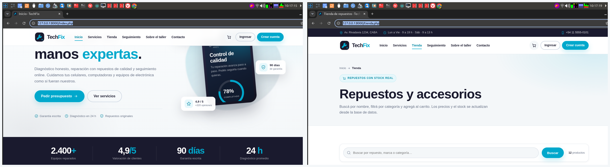

# TechFix · Sitio web del taller de reparaciones

Proyecto integrador de **Programación Web** para el taller **TechFix** (reparación de
celulares, computadoras y electrónica). Reúne la migración a PHP, formularios seguros,
base de datos relacional, CRUD con PDO, autenticación, una API JSON y dos módulos MVC.

> **Alumno:** Núñez Marcos Agustín
> **Materia:** Programación Web
> **Trabajos:** TP4 a TP10
> **Repositorio:** <https://github.com/MarcosNpm/Techfix>

---

## Índice

1. [Descripción](#descripción)
2. [Tecnologías](#tecnologías)
3. [Puesta en marcha](#puesta-en-marcha)
4. [Credenciales de prueba](#credenciales-de-prueba)
5. [Estructura del proyecto](#estructura-del-proyecto)
6. [Recorrido por los trabajos prácticos](#recorrido-por-los-trabajos-prácticos)
   - [TP4 · Migración a PHP e includes](#tp4--migración-a-php-e-includes)
   - [TP5 · Formularios POST y GET](#tp5--formularios-post-y-get)
   - [TP6 · Base de datos y normalización](#tp6--base-de-datos-y-normalización)
   - [TP7 · PDO y CRUD](#tp7--pdo-y-crud)
   - [TP8 · Autenticación y roles](#tp8--autenticación-y-roles)
   - [TP9 · API JSON con Fetch](#tp9--api-json-con-fetch)
   - [TP10 · MVC nativo y framework](#tp10--mvc-nativo-y-framework)
7. [Rutas principales](#rutas-principales)
8. [Seguridad aplicada](#seguridad-aplicada)
9. [Capturas](#capturas)
10. [Flujo de Git](#flujo-de-git)
11. [Pruebas realizadas](#pruebas-realizadas)
12. [Notas y limitaciones](#notas-y-limitaciones)

---

## Descripción

TechFix es un sitio completo para un taller de reparaciones. Permite:

- Conocer los servicios del taller y pedir un presupuesto.
- Registrar una solicitud de reparación y seguir su estado con un código.
- Comprar repuestos desde un catálogo con carrito y pedidos.
- Enviar consultas desde un formulario de contacto.
- Registrarse, iniciar sesión y consultar el historial propio.
- Administrar servicios, reparaciones, usuarios y stock desde un panel con roles.

El diseño mantiene la identidad definida en el TP3: paleta **#1A1A2E**, **#00A8CC**,
**#F4F7F9**, **#FFFFFF** y **#333333**, tipografía limpia, tarjetas redondeadas y un
menú responsive.

---

## Tecnologías

| Capa | Herramienta |
| --- | --- |
| Servidor | PHP 8.4 (compatible con PHP 8.1+) |
| Base de datos | MySQL / MariaDB 10.4+ |
| Acceso a datos | PDO con consultas preparadas |
| Frontend | HTML5, CSS3 propio, JavaScript Vanilla |
| Asincronía | Fetch API + JSON |
| Framework (TP10-B) | Fat-Free Framework 3.9.3, incluido en `framework/lib/` |
| Entorno local | XAMPP, Laragon o servidor embebido de PHP |
| Control de versiones | Git + GitHub |

No se usa Composer ni dependencias externas: el proyecto funciona copiando la carpeta
y ejecutando el SQL.

---

## Puesta en marcha

### 1. Requisitos

- PHP 8.1 o superior con las extensiones `pdo_mysql`, `json` y `session`.
- MySQL 5.7+ o MariaDB 10.4+.
- Apache con `mod_rewrite` (recomendado) o el servidor embebido de PHP.

### 2. Copiar el proyecto

Con XAMPP, dentro de `htdocs`:

```bash
cd C:/xampp/htdocs
git clone https://github.com/MarcosNpm/Techfix.git TechFix
```

También se puede descomprimir el ZIP en `htdocs/TechFix`.

### 3. Crear la base de datos

```bash
mysql -h 127.0.0.1 -P 3306 -u root -p < tp6/schema.sql
mysql -h 127.0.0.1 -P 3306 -u root -p < tp6/consultas.sql
```

- `tp6/schema.sql` crea la base `techfix_db`, las tablas, índices y claves foráneas.
- `tp6/consultas.sql` carga roles, usuarios, servicios, productos, reparaciones y pedidos de ejemplo.

### 4. Configurar el entorno

```bash
cp .env.example .env
```

Editar `.env` con los datos locales:

```ini
APP_NAME="TechFix"
APP_ENV=local
APP_DEBUG=true
APP_URL=http://localhost/TechFix
APP_TIMEZONE=America/Argentina/Buenos_Aires

DB_HOST=127.0.0.1
DB_PORT=3306
DB_NAME=techfix_db
DB_USER=root
DB_PASS=
DB_CHARSET=utf8mb4

APP_KEY=cambiar-esta-clave-por-una-propia
```

El archivo `.env` **no se versiona** (está en `.gitignore`). Solo se sube `.env.example`.

### 5. Ejecutar

**Opción A · XAMPP/Apache**

Abrir <http://localhost/TechFix/index.php>.

**Opción B · Servidor embebido de PHP**

Desde la raíz del proyecto:

```bash
php -S 127.0.0.1:8000 router.php
```

Abrir <http://127.0.0.1:8000/index.php>.

> `router.php` es necesario para que funcionen las rutas amigables del módulo
> Fat-Free (`/framework/reportes`, `/framework/reportes/4`, `/framework/api/stock`).

### 6. Permisos de escritura

La demo del TP5 guarda mensajes en `clase5/data/mensajes.json`. En Linux/macOS:

```bash
chmod -R 775 clase5/data
```

En Windows no hace falta configuración adicional.

---

## Credenciales de prueba

| Rol | Correo | Contraseña |
| --- | --- | --- |
| Administrador | `admin@techfix.com.ar` | `Admin1234!` |
| Cliente | `cliente@demo.com` | `Cliente1234!` |

Código de seguimiento de ejemplo: **TF-260901-A1B2C3**.

---

## Estructura del proyecto

```
TechFix/
├── index.php                  # Inicio
├── servicios.php              # Listado de servicios
├── servicio.php               # Detalle de un servicio
├── solicitud.php              # Formulario POST de reparación
├── confirmacion.php           # Confirmación con código de seguimiento
├── seguimiento.php            # Consulta pública por código
├── tienda.php                 # Catálogo de productos
├── carrito.php                # Carrito y creación de pedidos
├── contacto.php               # Formulario POST de contacto
├── sobre-el-taller.php        # Historia, equipo y valores
├── registro.php               # Alta de usuarios (TP8)
├── login.php                  # Inicio de sesión (TP8)
├── logout.php                 # Cierre de sesión
├── dashboard.php              # Panel del cliente (TP8)
├── admin_panel.php            # Resumen administrativo (TP8)
├── router.php                 # Router para el servidor embebido
│
├── includes/
│   ├── bootstrap.php          # Entorno, URL base y sesión segura
│   ├── funciones.php          # Helpers: e(), url(), CSRF, fechas, estados
│   ├── header.php             # <head>, metadatos y título dinámico (TP4)
│   ├── nav.php                # Menú con estado activo (TP4)
│   ├── footer.php             # Pie y scripts (TP4)
│   ├── componentes.php        # Tarjetas, badges y bloques reutilizables
│   ├── iconos.php             # Íconos SVG inline
│   ├── auth_guard.php         # Guardián de sesión y roles (TP8)
│   └── admin_sidebar.php      # Navegación del panel
│
├── config/
│   ├── env.php                # Carga de .env sin dependencias
│   └── conexion.php           # Conexión PDO con try/catch (TP7)
│
├── admin/
│   ├── index.php              # Listado de servicios
│   ├── crear.php              # Alta de servicio
│   ├── editar.php             # Edición de servicio
│   ├── eliminar.php           # Baja con confirmación
│   ├── reparaciones.php       # Gestión de reparaciones
│   └── usuarios.php           # Roles y estado de usuarios
│
├── api/
│   └── buscar_productos.php   # Endpoint JSON (TP9)
│
├── assets/
│   ├── css/estilos.css        # Sistema de diseño completo
│   ├── js/main.js             # Menú, filtros y comportamientos
│   ├── js/tienda.js           # Búsqueda asincrónica (TP9)
│   └── img/*.svg              # Íconos e ilustraciones
│
├── clase5/                    # TP5 autocontenido
│   ├── index.php              # Formulario POST + buscador GET
│   ├── mensajes.php           # Mensajes persistidos
│   ├── includes/              # Header, footer y funciones
│   ├── assets/                # CSS y JS propios
│   └── data/                  # JSON de catálogo y mensajes
│
├── tp6/                       # TP6
│   ├── schema.sql             # DDL completo
│   ├── consultas.sql          # Datos y consultas de ejemplo
│   └── NORMALIZACION.md       # Análisis hasta 3FN
│
├── app/                       # TP10-A · MVC nativo
│   ├── Models/                # Modelo y Producto
│   ├── Controllers/           # Controlador base y TiendaController
│   ├── Views/                 # Layout, catálogo, detalle y 404
│   └── Core/View.php          # Renderizador de vistas
├── mvc/index.php              # Front controller del MVC nativo
│
├── framework/                 # TP10-B · Fat-Free Framework
│   ├── index.php              # Front controller y rutas
│   ├── app/config.php         # Configuración de la base
│   ├── app/controllers/       # ReportesController
│   ├── app/models/            # Producto con DB\SQL\Mapper
│   ├── app/views/             # Plantillas y layouts
│   ├── lib/                   # Fat-Free 3.9.3 incluido
│   └── .htaccess              # Rewrite para Apache
│
├── docs/capturas/             # Evidencias 01 a 31
├── .env.example
├── .gitignore
└── README.md
```

---

## Recorrido por los trabajos prácticos

### TP4 · Migración a PHP e includes

**Objetivo:** pasar el prototipo estático del TP3 a PHP con componentes reutilizables.

| Requisito | Implementación |
| --- | --- |
| Migración a `.php` | Todas las páginas usan PHP y comparten `includes/bootstrap.php`. |
| Header separado | `includes/header.php` contiene `<!DOCTYPE>`, `<head>`, metadatos y apertura del `body`. |
| Navegación separada | `includes/nav.php` centraliza el menú, el carrito y la sesión. |
| Footer separado | `includes/footer.php` cierra el layout y carga los scripts. |
| Título dinámico | Cada página define `$titulo` y el header imprime `<?= e($titulo) ?> · TechFix`. |
| Menú activo | Cada página define `$pagina_activa`; `menu_activo()` agrega la clase `active`. |
| Variables de entorno | `config/env.php` lee `.env`; se versiona `.env.example`. |
| `.gitignore` | Excluye `.env`, logs, dependencias y datos temporales. |
| README + capturas | Este documento y las evidencias 26 a 31. |

**Evidencias**



| Archivo | Captura |
| --- | --- |
| `.env.example` | `docs/capturas/27-tp4-env-example.png` |
| `includes/header.php` | `docs/capturas/28-tp4-includes-header.png` |
| `includes/nav.php` | `docs/capturas/29-tp4-includes-nav.png` |
| `includes/footer.php` | `docs/capturas/30-tp4-includes-footer.png` |
| `config/env.php` | `docs/capturas/31-tp4-config-env.png` |

---

### TP5 · Formularios POST y GET

**Carpeta exacta:** `clase5/`

Es una demo **autocontenida**: no necesita la base de datos ni el resto del sitio.
Se puede abrir directamente en <http://localhost/TechFix/clase5/index.php>.

| Requisito | Implementación |
| --- | --- |
| Formulario POST | Contacto con nombre, email, teléfono, asunto, mensaje y aceptación de privacidad. |
| Formulario GET | Buscador del catálogo por `?q=...`, con resultados filtrados. |
| Sanitización | `limpiar()` aplica `trim`, elimina etiquetas y normaliza espacios; `limpiar_multilinea()` para el mensaje. |
| Validación | Longitudes, formato de email, teléfono, asunto permitido y obligatoriedad. |
| Feedback | Errores por campo y mensaje general; confirmación con patrón PRG. |
| Persistencia de campos | Ante un error, los valores válidos se vuelven a mostrar. |
| Persistencia de datos | Los mensajes se guardan en `clase5/data/mensajes.json` y se listan en `mensajes.php`. |
| Seguridad | Escape con `e()`, token CSRF y bloqueo de mayúsculas/etiquetas. |

**Flujo probado**

1. Enviar el formulario vacío → errores por campo.
2. Enviar un email inválido → se conservan los demás valores.
3. Enviar datos válidos → redirección con mensaje de éxito.
4. Ver el mensaje en `clase5/mensajes.php`.
5. Buscar `bateria` por GET → catálogo filtrado.

**Capturas**

| Vista | Captura |
| --- | --- |
| Formulario y estado | `docs/capturas/10-clase5.png` |
| Búsqueda GET | `docs/capturas/11-clase5-busqueda.png` |
| Mensajes persistidos | `docs/capturas/12-clase5-mensajes.png` |
| Validación del sitio principal | `docs/capturas/09-contacto-validacion.png` |

---

### TP6 · Base de datos y normalización

**Carpeta:** `tp6/`

| Archivo | Contenido |
| --- | --- |
| `schema.sql` | DDL de 13 tablas, claves primarias, foráneas, índices y borrado lógico. |
| `consultas.sql` | Datos de prueba y consultas `SELECT`, `JOIN`, agregaciones y actualizaciones. |
| `NORMALIZACION.md` | Justificación de 1FN, 2FN y 3FN con ejemplos del modelo. |

**Tablas**

`roles`, `usuarios`, `categorias_servicio`, `servicios`, `estados_reparacion`,
`reparaciones`, `categorias_producto`, `productos`, `pedidos`, `detalle_pedidos`,
`etiquetas`, `servicio_etiqueta` y `consultas`.

**Decisiones de diseño**

- Claves primarias `INT UNSIGNED AUTO_INCREMENT`.
- Claves foráneas con `ON UPDATE CASCADE` y `ON DELETE RESTRICT` o `SET NULL` según el caso.
- `DECIMAL(10,2)` para precios y costos.
- `utf8mb4_unicode_ci` para admitir acentos, emojis y caracteres especiales.
- Estados de reparación en tabla maestra para evitar texto libre.
- Relación N:M entre servicios y etiquetas resuelta con `servicio_etiqueta`.
- Borrado lógico en servicios y productos mediante `activo`.

**Consultas destacadas**

- Reparaciones con cliente, servicio y estado.
- Productos con stock bajo mínimo.
- Total facturado por mes.
- Servicios más solicitados.
- Detalle completo de un pedido.

---

### TP7 · PDO y CRUD

**Conexión:** `config/conexion.php`

```php
$dsn = "mysql:host={$dbHost};port={$dbPuerto};dbname={$dbNombre};charset={$dbCharset}";

$opciones = [
    PDO::ATTR_ERRMODE            => PDO::ERRMODE_EXCEPTION,
    PDO::ATTR_DEFAULT_FETCH_MODE => PDO::FETCH_ASSOC,
    PDO::ATTR_EMULATE_PREPARES   => false,
];

try {
    $pdo = new PDO($dsn, $dbUsuario, $dbClave, $opciones);
} catch (PDOException $e) {
    error_log('[TechFix] Error de conexión PDO: ' . $e->getMessage());
    // Respuesta amigable, sin credenciales ni detalles internos.
}
```

**CRUD de servicios**

| Operación | Archivo | Detalle |
| --- | --- | --- |
| Crear | `admin/crear.php` | Formulario validado + `INSERT` preparado. |
| Leer | `admin/index.php` | Listado con búsqueda y filtro por categoría. |
| Actualizar | `admin/editar.php` | Carga datos, valida y ejecuta `UPDATE`. |
| Eliminar | `admin/eliminar.php` | Confirmación, token CSRF y borrado lógico. |

**Otras operaciones integradas**

- `solicitud.php` crea una reparación y genera un código `TF-AAAAMMDD-XXXXXX`.
- `seguimiento.php` consulta el estado por código.
- `carrito.php` crea un pedido y su detalle en una transacción.
- `contacto.php` guarda consultas.
- `admin/reparaciones.php` actualiza estado, observaciones y costo final.
- `admin/usuarios.php` cambia rol y estado de las cuentas.

**Capturas**

| Vista | Captura |
| --- | --- |
| Panel administrativo | `docs/capturas/16-admin-panel.png` |
| Listado de servicios | `docs/capturas/17-admin-servicios.png` |
| Alta de servicio | `docs/capturas/18-admin-crear.png` |
| Gestión de reparaciones | `docs/capturas/19-admin-reparaciones.png` |
| Usuarios y roles | `docs/capturas/20-admin-usuarios.png` |

---

### TP8 · Autenticación y roles

| Requisito | Implementación |
| --- | --- |
| Registro | `registro.php` valida datos, verifica email único y usa `password_hash($password, PASSWORD_BCRYPT)`. |
| Login | `login.php` busca al usuario y compara con `password_verify()`. |
| Logout | `logout.php` limpia la sesión y destruye la cookie. |
| Regeneración de sesión | `session_regenerate_id(true)` después de un login correcto. |
| Guardián | `includes/auth_guard.php` exige sesión y `verificar_rol('admin')` para el panel. |
| Vistas protegidas | `dashboard.php` (cliente) y `admin_panel.php` + `admin/*` (administrador). |
| Respuesta 403 | Página de acceso denegado con código HTTP real. |
| Contraseñas | Nunca se guardan en texto plano. |

**Sesión segura**

- Nombre propio: `TECHFIXSESSID`.
- Cookies `HttpOnly` y `SameSite=Lax`.
- `session.use_strict_mode = 1`.
- `Secure` automático cuando el sitio corre sobre HTTPS.
- Mensajes de error genéricos para no revelar si existe un correo.

**Capturas**

| Vista | Captura |
| --- | --- |
| Login | `docs/capturas/13-login.png` |
| Panel del cliente | `docs/capturas/14-dashboard-cliente.png` |
| Acceso denegado 403 | `docs/capturas/15-acceso-denegado-403.png` |

---

### TP9 · API JSON con Fetch

**Endpoint:** `api/buscar_productos.php`

| Método | Parámetros | Respuesta |
| --- | --- | --- |
| `GET` | `q`, `categoria`, `limite` | `200` con productos |
| Cualquier otro | — | `405 Method Not Allowed` |
| `GET` | `limite` fuera de 1–48 | `400 Bad Request` |
| `GET` | `q` mayor a 80 caracteres | `400 Bad Request` |
| `GET` | Error de base | `500 Internal Server Error` |

**Ejemplo**

```http
GET /api/buscar_productos.php?q=ssd&limite=12
```

```json
{
  "status": "success",
  "total": 1,
  "data": [
    {
      "id": 10,
      "nombre": "SSD Kingston NV2 1 TB NVMe",
      "precio": "98000.00",
      "stock": 14,
      "categoria": "Almacenamiento",
      "categoria_slug": "almacenamiento"
    }
  ]
}
```

**Frontend:** `assets/js/tienda.js`

- Escucha el evento `input` del buscador.
- Cancela la petición anterior con `AbortController`.
- Usa `fetch()` y valida `response.ok`.
- Actualiza el DOM con `renderProductos()` sin recargar.
- Muestra un estado de carga, un mensaje de error y el total encontrado.
- Aplica `debounce` de 300 ms para no saturar el servidor.

**Capturas**

| Vista | Captura |
| --- | --- |
| Catálogo | `docs/capturas/06-tienda.png` |
| Búsqueda asincrónica | `docs/capturas/07-tienda-busqueda-ajax.png` |
| Carrito con pedido | `docs/capturas/25-carrito.png` |

---

### TP10 · MVC nativo y framework

#### Parte A · MVC nativo (`app/` + `mvc/`)

| Capa | Archivo | Responsabilidad |
| --- | --- | --- |
| Modelo base | `app/Models/Modelo.php` | Recibe el `PDO` y ejecuta consultas preparadas. |
| Modelo | `app/Models/Producto.php` | Buscar, listar, filtrar y encontrar productos. |
| Controlador base | `app/Controllers/Controlador.php` | Acceso al renderizador. |
| Controlador | `app/Controllers/TiendaController.php` | Sanitiza `$_GET`, valida, responde 404 y elige la vista. |
| Vista | `app/Core/View.php` | `extract()` + `ob_start()` para renderizar. |
| Vistas | `app/Views/tienda/*.php` | Listado, detalle y error 404. |
| Front controller | `mvc/index.php` | Autoload, conexión y despacho de acciones. |

**Rutas**

| URI | Acción |
| --- | --- |
| `mvc/index.php` | Catálogo completo |
| `mvc/index.php?accion=index&q=ssd` | Búsqueda |
| `mvc/index.php?accion=index&categoria=almacenamiento` | Filtro |
| `mvc/index.php?accion=ver&id=4` | Detalle |
| `mvc/index.php?accion=otra` | 404 |

#### Parte B · Fat-Free Framework (`framework/`)

Módulo **independiente** con rutas, controlador, modelo ORM y vistas.

| Componente | Archivo |
| --- | --- |
| Front controller y routing | `framework/index.php` |
| Controlador | `framework/app/controllers/ReportesController.php` |
| Modelo ORM | `framework/app/models/Producto.php` (`DB\SQL\Mapper`) |
| Vistas | `framework/app/views/reportes/*.html` |
| Layouts | `framework/app/views/layouts/*.html` |
| Configuración | `framework/app/config.php` |

**Rutas**

| Método | URI | Acción |
| --- | --- | --- |
| GET | `/framework/` | Reporte de stock |
| GET | `/framework/reportes` | Reporte general |
| GET | `/framework/reportes?q=ssd` | Búsqueda con ORM |
| GET | `/framework/reportes/4` | Detalle por ruta dinámica |
| GET | `/framework/api/stock` | JSON del stock |

**Capturas**

| Vista | Captura |
| --- | --- |
| MVC · catálogo | `docs/capturas/21-mvc-catalogo.png` |
| MVC · detalle | `docs/capturas/22-mvc-detalle.png` |
| Framework · reporte | `docs/capturas/23-framework-reporte.png` |
| Framework · detalle | `docs/capturas/24-framework-detalle.png` |

---

## Rutas principales

| URI | Descripción | Acceso |
| --- | --- | --- |
| `index.php` | Inicio | Público |
| `servicios.php` | Servicios | Público |
| `servicio.php?id=1` | Detalle | Público |
| `solicitud.php` | Pedir reparación | Público |
| `seguimiento.php?codigo=...` | Seguir reparación | Público |
| `tienda.php` | Catálogo | Público |
| `carrito.php` | Carrito y pedido | Público |
| `contacto.php` | Contacto | Público |
| `registro.php` | Crear cuenta | Público |
| `login.php` | Ingresar | Público |
| `dashboard.php` | Panel del cliente | Sesión |
| `admin_panel.php` | Resumen administrativo | Admin |
| `admin/index.php` | CRUD de servicios | Admin |
| `admin/reparaciones.php` | Reparaciones | Admin |
| `admin/usuarios.php` | Usuarios y roles | Admin |
| `api/buscar_productos.php` | API JSON | Público |
| `clase5/index.php` | Demo TP5 | Público |
| `mvc/index.php` | MVC nativo | Público |
| `framework/reportes` | Módulo Fat-Free | Público |

---

## Seguridad aplicada

- **SQL:** 100 % de las consultas usan `prepare()` + `execute()` con parámetros enlazados.
- **XSS:** toda salida dinámica pasa por `e()` (`htmlspecialchars` con `ENT_QUOTES`).
- **CSRF:** formularios POST incluyen `csrf_field()` y validan con `verificar_csrf()`.
- **Contraseñas:** `password_hash()` con `PASSWORD_BCRYPT` y `password_verify()`.
- **Sesiones:** regeneración de ID, cookies `HttpOnly`, `SameSite=Lax` y `strict_mode`.
- **Autorización:** `auth_guard.php` y `verificar_rol()` para separar cliente y admin.
- **Errores:** los detalles técnicos van a `error_log`; el usuario recibe mensajes claros.
- **Cabeceras:** `X-Content-Type-Options`, `X-Frame-Options` y `Referrer-Policy`.
- **Entorno:** credenciales en `.env`, excluido del repositorio.
- **Validación doble:** controles HTML (`required`, `type`) y validación definitiva en servidor.

---

## Capturas

Todas las evidencias están en `docs/capturas/` (31 imágenes).

| # | Archivo | Contenido |
| --- | --- | --- |
| 01 | `01-inicio.png` | Página de inicio |
| 02 | `02-servicios.png` | Listado de servicios |
| 03 | `03-servicio-detalle.png` | Detalle de servicio |
| 04 | `04-solicitud.png` | Formulario de reparación |
| 05 | `05-seguimiento.png` | Seguimiento por código |
| 06 | `06-tienda.png` | Catálogo |
| 07 | `07-tienda-busqueda-ajax.png` | Búsqueda Fetch (TP9) |
| 08 | `08-contacto.png` | Contacto |
| 09 | `09-contacto-validacion.png` | Validación y persistencia |
| 10 | `10-clase5.png` | Demo TP5 |
| 11 | `11-clase5-busqueda.png` | Búsqueda GET |
| 12 | `12-clase5-mensajes.png` | Mensajes persistidos |
| 13 | `13-login.png` | Login |
| 14 | `14-dashboard-cliente.png` | Panel del cliente |
| 15 | `15-acceso-denegado-403.png` | 403 por rol |
| 16 | `16-admin-panel.png` | Panel admin |
| 17 | `17-admin-servicios.png` | CRUD de servicios |
| 18 | `18-admin-crear.png` | Alta de servicio |
| 19 | `19-admin-reparaciones.png` | Reparaciones |
| 20 | `20-admin-usuarios.png` | Usuarios |
| 21 | `21-mvc-catalogo.png` | MVC nativo |
| 22 | `22-mvc-detalle.png` | Detalle MVC |
| 23 | `23-framework-reporte.png` | Fat-Free |
| 24 | `24-framework-detalle.png` | Detalle Fat-Free |
| 25 | `25-carrito.png` | Carrito |
| 26 | `26-tp4-titulo-menu.png` | Título dinámico y menú activo |
| 27 | `27-tp4-env-example.png` | `.env.example` |
| 28 | `28-tp4-includes-header.png` | `header.php` |
| 29 | `29-tp4-includes-nav.png` | `nav.php` |
| 30 | `30-tp4-includes-footer.png` | `footer.php` |
| 31 | `31-tp4-config-env.png` | `config/env.php` |

---

## Flujo de Git

El proyecto se desarrolló en una rama de trabajo con un commit descriptivo por etapa.

```text
main
└── feature/migracion-php-ssi
    ├── TP4: migración a PHP e includes
    ├── TP5: formularios POST y GET
    ├── TP6: esquema y normalización
    ├── TP7: PDO y CRUD
    ├── TP8: autenticación y roles
    ├── TP9: API JSON con Fetch
    └── TP10: MVC nativo y Fat-Free
```

Comandos utilizados:

```bash
git checkout -b feature/migracion-php-ssi
git add .
git commit -m "TP4: migración a PHP con includes y títulos dinámicos"
git commit -m "TP5: formularios POST y GET con validación y persistencia"
git commit -m "TP6: esquema relacional y normalización"
git commit -m "TP7: conexión PDO y CRUD de servicios"
git commit -m "TP8: registro, login y control de roles"
git commit -m "TP9: endpoint JSON y búsqueda asincrónica"
git commit -m "TP10: MVC nativo y módulo Fat-Free"
git checkout main
git merge feature/migracion-php-ssi
```

---

## Pruebas realizadas

| Prueba | Resultado |
| --- | --- |
| Inicio, servicios y detalle cargan desde MySQL | OK |
| Solicitud crea reparación y código de seguimiento | OK |
| Seguimiento encuentra el código | OK |
| Tienda lista productos y filtra por categoría | OK |
| Búsqueda Fetch devuelve JSON y actualiza el DOM | OK |
| Carrito agrega, actualiza cantidades y crea pedido | OK |
| Contacto valida, persiste y muestra feedback | OK |
| Login admin y cliente | OK |
| Cliente recibe 403 en el panel admin | OK |
| CRUD de servicios: crear, editar y eliminar | OK |
| Actualización de estado de reparación | OK |
| Cambio de rol y estado de usuario | OK |
| Registro con email duplicado | OK (error controlado) |
| Demo TP5: POST, GET, errores y persistencia | OK |
| MVC nativo: listado, búsqueda, detalle y 404 | OK |
| Fat-Free: rutas, ORM, detalle y JSON | OK |
| Endpoint con método incorrecto devuelve 405 | OK |
| Endpoint con `limite` inválido devuelve 400 | OK |

---

## Notas y limitaciones

- El proyecto no usa Composer: Fat-Free está incluido en `framework/lib/` para que
  funcione en cualquier XAMPP sin instalar dependencias.
- Las capturas se generaron con Chromium y datos reales de la base.
- El enlace público de Figma del TP3 no está disponible; el prototipo se documenta
  en `docs/TP3.pdf` y se refleja en el sitio actual.
- La publicación en GitHub requiere credenciales del repositorio
  <https://github.com/MarcosNpm/Techfix>. El historial local queda preparado con los
  commits de cada TP.

---

## Autor

**Núñez Marcos Agustín**
Programación Web · TechFix · 2026
